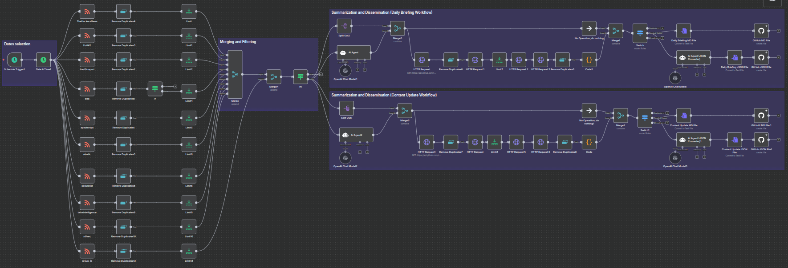
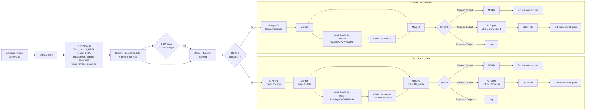

# AI threat intel daily briefing and content update: n8n to a GitHub knowledge base

> An **n8n** workflow that reads **10 threat research feeds** every morning. Two **OpenAI-powered AI agents** turn each new article into two products: a **Daily Briefing** for leadership and SOC, and a **Content Update** of detection-oriented modus operandi for detection engineers. Both are checked against what is already in GitHub and **committed as Markdown and JSON** to a threat intelligence knowledge base repository.


---

## Blog posts

I wrote about this n8n automation work in more detail here:

- [How I Automated My Threat Intelligence Workflow with n8n (and What It Taught Me)](https://medium.com/meetcyber/how-i-automated-my-threat-intelligence-workflow-with-n8n-and-what-it-taught-me-f8c14aba6c72) on Medium (MeetCyber)
- [From Headlines to Slack: Automating Cyber Threat Intelligence Delivery](https://bloo.io/blog/from-headlines-to-slack-automating-cyber-threat-intelligence-delivery) on the Bloo blog (June 2025)

## Why I built this

Different teams need different things from the same article:

| Audience | Question | Product |
|---|---|---|
| Leadership / SOC lead | *What happened, who did it, is it exploited in the wild, and how do we stay safe?* | **Daily Briefing** |
| Detection engineering / threat hunting | *What exactly does the attacker do, and what would we see in our telemetry?* | **Content Update** |

Writing both by hand for 20–30 articles a day isn't sustainable. This POC has AI agents draft both products from the same source article. It also stores every output in **GitHub as a versioned, searchable intel knowledge base** (`.md` for people, `.json` for tools), and it **checks GitHub first**, so an article already processed is never written twice.

## Workflow canvas



The left half (**Dates selection**, **Merging and Filtering**) is shared ingestion. The right half has two lanes: **Summarization and Dissemination (Daily Briefing Workflow)** on top and **Summarization and Dissemination (Content Update Workflow)** below.

## Architecture



---

## How each stage and node works

### 1. Dates selection

| Node | Type | Role |
|---|---|---|
| **Schedule Trigger1** | `scheduleTrigger` | Runs daily at **09:01** (Asia/Kolkata workflow time zone). It also supplies `Year`, `Month`, `Day of month` and `Readable date`, which build the GitHub folder path and the commit message. |
| **Date & Time1** | `dateTime` | Computes `Yesterday_Date` (timestamp minus 1 day) as a date reference |

### 2. Collection: 10 curated threat research feeds

| Node | Feed | Intel value |
|---|---|---|
| **TheHackersNews** | `feeds.feedburner.com/TheHackersNews` | Breaking vulnerability and campaign news |
| **Unit42** | `feeds.feedburner.com/Unit42` | Palo Alto Networks threat research |
| **thedfirreport** | `thedfirreport.com/feed/` | Full intrusion write-ups (great for detections) |
| **cisa** | `cisa.gov/cybersecurity-advisories/all.xml` | US government advisories |
| **specterops** | `specterops.io/blog/category/research/feed/` | Offensive tradecraft research |
| **elastic** | `elastic.co/security-labs/rss/feed.xml` | Malware analysis with detection logic |
| **securelist** | `securelist.com/feed/` | Kaspersky APT and malware research |
| **talosintelligence** | `blog.talosintelligence.com/rss/` | Cisco Talos threat research |
| **offsec** | `offsec.blog/category/blog/feed/` | Offensive security research |
| **group-ib** | `group-ib.com/feed/blogfeed/` | Cybercrime and fraud research |

### 3. Merging and filtering

| Node(s) | Type | Role |
|---|---|---|
| **Remove Duplicates…** (one per feed) | `removeDuplicates` on `title` | Removes repeated items inside each feed |
| **Limit…** (one per feed) | `limit` = 3 | At most **3 newest articles per source**, which gives balanced coverage at a controlled LLM cost |
| **If** (CISA branch) | `if`, regex on `link` (`ics`) or `title` (`Industrial Control System(s)`) | Drops high-volume **ICS advisories** so CISA doesn't flood the briefing |
| **Merge** (9 inputs) + **Merge4** | `merge` (append) | Combines all sources into one stream |
| **If1** | `if`, regex `/` on `title` | Drops titles that contain `/`, because the title becomes the GitHub file name and `/` would create unwanted sub-folders |

### 4a. Daily Briefing lane

| Node | Type | Role |
|---|---|---|
| **AI Agent** + **OpenAI Chat Model1** | LangChain Agent + `lmChatOpenAi` | Writes the **Daily Briefing** for each article (prompt below) |
| **Split Out2** | `splitOut` on `title` | Keeps the article title next to the AI output |
| **Merge5** | `merge`, combine by position | Pairs each AI output with its title |
| **HTTP Request** | GitHub REST `GET /repos/{org}/{repo}/contents/Daily Briefing` | Lists what is already in the knowledge base |
| **Remove Duplicates6** → **HTTP Request 1** → **Limit7** → **HTTP Request 2** → **HTTP Request 3** | `httpRequest` chain | Walks the `YYYY/MM/DD` folder tree through the Contents API (`{{ $json.path }}`) |
| **Remove  Duplicates8** | `removeDuplicates` on `name` | One entry per existing file |
| **Code5** | `code` (JavaScript) | Strips the extension from each file name, giving `file_name` |
| **No Operation, do nothing** | `noOp` | Passes the new items through to the merge |
| **Merge1** | `merge`, match `title` = `file_name`, keep everything | Joins *new AI items* with *existing GitHub files* |
| **Switch** | `switch` | **Duplicate Output** (title already on GitHub) is dropped. **Needed Output** continues. The fallback is "Already on Github". |
| **Daily Briefing MD File** | `convertToFile` → text | `<title>.md` |
| **AI Agent (JSON Converter)** + **OpenAI Chat Model** | Agent + `gpt-4o-mini` | Converts the Markdown brief to **JSON with UPPERCASE keys** for machine use |
| **Daily Briefing JSON File** | `convertToFile` → text | `<title>.json` |
| **GitHub MD File / GitHub JSON File** | `github` → create file | Commits to `Daily Briefing/<Year>/<Month>/<Day>/<title>.md\|.json` with the message `Daily Briefing for <date>` |

### 4b. Content Update lane

This lane mirrors 4a, with **AI Agent2** (+ OpenAI Chat Model2), **Split Out7**, **Merge6**, **HTTP Request1**, **HTTP Request**, **HTTP Request 5** and **HTTP Request 6**, **Remove  Duplicates9**, **Code**, **Merge2**, **Switch1**, **Content Update MD/JSON File**, **AI Agent (JSON Converter)1** (+ OpenAI Chat Model3) and **GitHub1 MD File 1 / GitHub JSON File1**. It writes under `Content Update/<Year>/<Month>/<Day>/`.

---

## How the AI agents are built

There are **4 LLM agents** in total: **2 analyst agents** and **2 formatter agents**. Each one is an `@n8n/n8n-nodes-langchain.agent` root node connected to an **OpenAI Chat Model** sub-node through the `ai_languageModel` port.

```text
Article item ──► [ AI Agent  ◄── OpenAI Chat Model ]  ──► Markdown brief ──► [ JSON Converter Agent ◄── gpt-4o-mini ] ──► JSON
                  user prompt: task + n8n expressions                          system: "convert to JSON, UPPERCASE keys,
                  system msg: Markdown formatting contract                            no ``` fences"
```

- **Prompt type `define`.** The user prompt is built per item from `{{ $json.title }}`, `{{ $json.content }}` and `{{ $json.link }}`.
- **The system message is a formatting contract.** It sets Markdown headings, **bold labels**, 4-space indents, `---` rules between sections, no code fences, no `&emsp;`, and plain-text reference links. The result reads like a professional briefing document.
- **Chained agents.** The output of the analyst agent becomes the input of the JSON converter agent, which is a simple **multi-agent pipeline** (writer → formatter). It produces one human-readable and one machine-readable artifact.
- **Credentials** are held in n8n's credential store and referenced by ID only, never stored in the JSON.

### Agentic tasks

<details open>
<summary><b>AI Agent: Daily Briefing analyst</b></summary>

```text
Title: {{ $json.title }}
Summary: read the article content and summarize it in 120 words. Include the threat actor,
vulnerability details, CVE ID, CVSS score, methodology and tools used (each if present).
Threat Dynamics: most importantly, check whether a vulnerability has been exploited in the wild.
Remediation: remediations, patches or techniques mentioned (≤ 60 words). Add your own inference
only for OWASP Top 10 vulnerabilities.
Reference: {{ $json.link }}
```
**Task:** summarisation, entity extraction (actor, CVE, CVSS, tools), and an **exploited-in-the-wild assessment** for prioritisation, plus remediation guidance.
</details>

<details open>
<summary><b>AI Agent2: Content Update (detection engineering) analyst</b></summary>

```text
Title: {{ $json.title }}
Summary: ≤ 120 words, naming the campaign / actor.
Modus Operandi: the vulnerability being exploited, focusing on specific scenarios that can be
detected (by a SIEM, without saying "SIEM").
Mitigations: extract mitigations from the article (≤ 75 words).
Reference: {{ $json.link }}
Focus only on detections with the highest signal-to-noise ratio.
```
**Task:** turns narrative reporting into **detection hypotheses**, meaning attacker behaviours worth alerting on, ranked by signal-to-noise. This is the input a detection engineer needs to write Sigma, KQL or SPL rules.
</details>

<details>
<summary><b>AI Agent (JSON Converter) / (JSON Converter)1</b></summary>

```text
Read the data in Prompt (User Message) and convert it into JSON format.
1. Do not add ```json fences.  2. Provide key names in capital letters.
```
**Task:** normalises the brief into structured data (`TITLE`, `SUMMARY`, `REMEDIATION`, …) so it can be ingested into a TIP, SIEM lookup or dashboard.
</details>

---

## Output: knowledge base layout

```text
Threat-Intelligence-Hub/
├── Daily Briefing/
│   └── 2026/11/23/
│       ├── <Article title>.md      ← human-readable brief
│       └── <Article title>.json    ← machine-readable brief
└── Content Update/
    └── 2026/11/23/
        ├── <Article title>.md
        └── <Article title>.json
```

Example Daily Briefing (`.md`):

```markdown
# <Article title>
---
**Summary:**
    <120-word summary: actor, CVE, CVSS, methodology, tools>
**Threat Dynamics:**
    <exploited in the wild? yes/no + evidence>
**Remediation:**
    <patches / mitigations ≤ 60 words>
**Reference:**
    https://…
```

---

## Setup

1. **Import** `workflow/threat-intel-content-update-daily-briefing.json` into n8n (*Workflows → Import from File*).
2. **Create a knowledge base repository** on GitHub (for example `Threat-Intelligence-Hub`) with top-level folders `Daily Briefing/` and `Content Update/`.
3. **Credentials:**
   - **OpenAI API** on every *OpenAI Chat Model* node.
   - **GitHub API** on the *GitHub … File* nodes. Use a fine-grained token with **Contents: read and write** on that one repository only.
   - **HTTP Request nodes:** replace the `Authorization: Bearer <GITHUB-TOKEN-HERE>` header. The better option is to switch the node to *Authentication → Predefined credential type → GitHub API*, so no token is ever kept in the workflow.
4. **Replace placeholders:** `YOUR_GITHUB_ORG` (owner field on the GitHub nodes and in the HTTP Request URLs), `Threat-Intelligence-Hub` (if you used another repo name) and `REPLACE_WITH_YOUR_CREDENTIAL_ID`.
5. Run it once with **Execute workflow**, then set it to **Active**.

## Related Blogs by Author

- https://medium.com/meetcyber/how-i-automated-my-threat-intelligence-workflow-with-n8n-and-what-it-taught-me-f8c14aba6c72
- https://bloo.io/blog/from-headlines-to-slack-automating-cyber-threat-intelligence-delivery

## Related projects

- [n8n-ai-cyber-news-briefing](https://github.com/Shailendra7727/n8n-ai-cyber-news-briefing): daily cyber news briefs to Slack and Gmail
- [n8n-ai-threat-intel-directory](https://github.com/Shailendra7727/n8n-ai-threat-intel-directory): an AI-built directory of attack campaigns, threat groups and malware

## License

[MIT](LICENSE). This is a proof of concept for portfolio and educational use.
